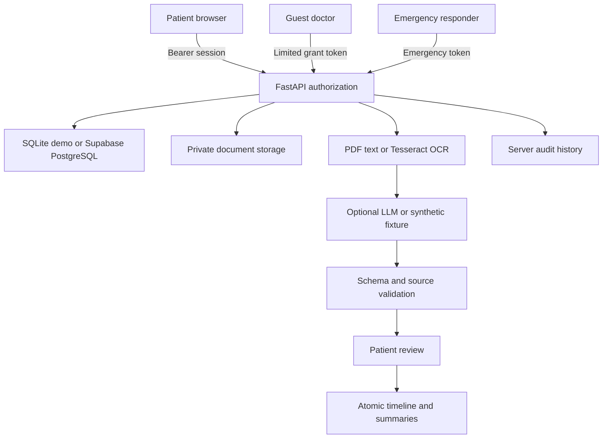

# Architecture and data flow

The React/Vite application shares one design system across patient, doctor and emergency pages. Supabase Auth handles live credentials; demo sessions use random opaque tokens and separate patient identities. Only the server holds the Supabase secret key. Live authorization checks current Supabase user identity plus explicit ownership; browser RLS provides an additional owner-read boundary.

The persistence contract stores validated entity documents in dedicated PostgreSQL JSONB tables (or a SQLite entity store for demo): profiles, medical_records, document_extractions, medical_events, medications, allergies, safety_alerts, sharing_grants, emergency_profiles, emergency_access_grants and audit_logs. Clinical tables have indexed record IDs and composite owner/record foreign keys. Grant hashes are unique indexed columns. Backend Pydantic schemas validate structure. There is no public mutation policy, and audit history is server-writable only.

Review retains the original OCR text and extraction, replaces derived entries atomically, and adds only reviewed facts to the timeline. Undated documents remain undated; medications default to unknown current use. Repeated reviews replace derived entries instead of duplicating them.

Guest grants contain selected record IDs and an expiry. The server hashes the supplied token, checks status/expiry and limits records, extraction, timeline, medications and allergies to that scope. No guest write API exists. Revocation blocks future downloads but cannot revoke bytes already received.

Emergency access is a separate grant class. Its response is constructed from a strict approved-field allowlist and never includes record IDs, full history or raw files. Rotation revokes previous emergency grants. All meaningful access and consent changes generate server audit events.

The deployed PostgreSQL/RLS and Supabase Storage path still needs live project verification. The schema is optimized for hackathon iteration; future work includes stricter per-field database constraints, direct indexed token lookups at scale, distributed throttling and durable background OCR jobs.
